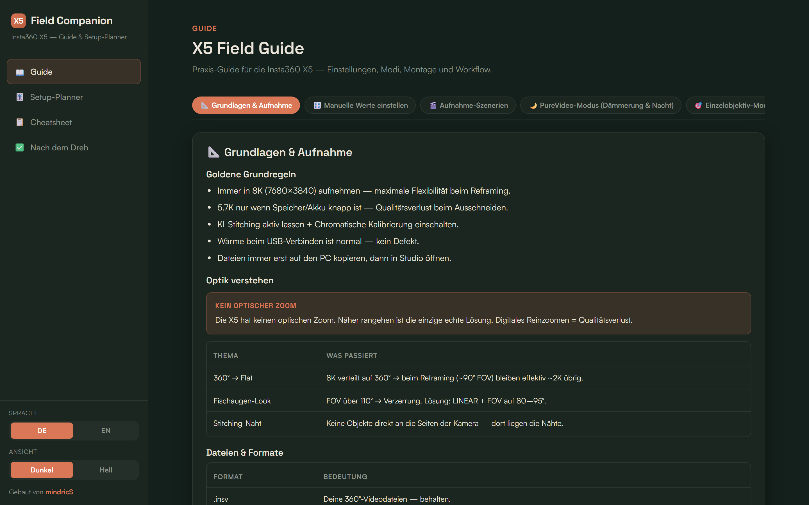

# X5 Field Companion

**Offline guide and setup planner for the Insta360 X5. One HTML file, no install, no tracking.**

Two modules in one tool:

1. **Guide**: practical knowledge on settings, modes (PureVideo, single-lens), mounting, audio, SD cards, troubleshooting and stock footage.
2. **Setup planner**: four questions (what you are shooting, time of day, environment, mount) produce a concrete camera setup plus a packing list. Entirely rule-based, no AI call, no internet needed, so it works in the field.

Plus a cheat sheet and a post-shoot checklist. German and English, dark and light, checklists and settings are saved in the browser.

## Use it

Download `X5-Field-Companion.html` and open it in any current browser (Chrome, Edge, Firefox, Safari). That is all.

Prefer a one-click download as a ZIP? It is also free on Gumroad, pay what you want: [mindriclab.gumroad.com/l/x5-field-companion](https://mindriclab.gumroad.com/l/x5-field-companion). Language and theme switch bottom-left.

## Why no AI

The tool is free and meant to work offline on a phone at the trailhead. A decision tree in JavaScript is predictable, costs nothing per use and never needs a connection. The logic lives in the single HTML file and is documented in [02_PLANNER_LOGIC.md](02_PLANNER_LOGIC.md).

## Project docs

- [00_PROJECT_BRIEF.md](00_PROJECT_BRIEF.md): scope and constraints
- [01_GUIDE_CONTENT.md](01_GUIDE_CONTENT.md): guide content
- [02_PLANNER_LOGIC.md](02_PLANNER_LOGIC.md): planner rules
- [03_FEATURES_BACKLOG.md](03_FEATURES_BACKLOG.md): backlog for a possible v2
- [04_DESIGN_BRAND.md](04_DESIGN_BRAND.md): visual theme
- `capture.js`: headless-Chrome screenshot script that produced `product-shots/`

## Status

Shipped, free. v2 ideas are in the backlog and depend on whether there is demand.

## License

MIT · Rico Herrmann · [mindriclab.de](https://www.mindriclab.de)
